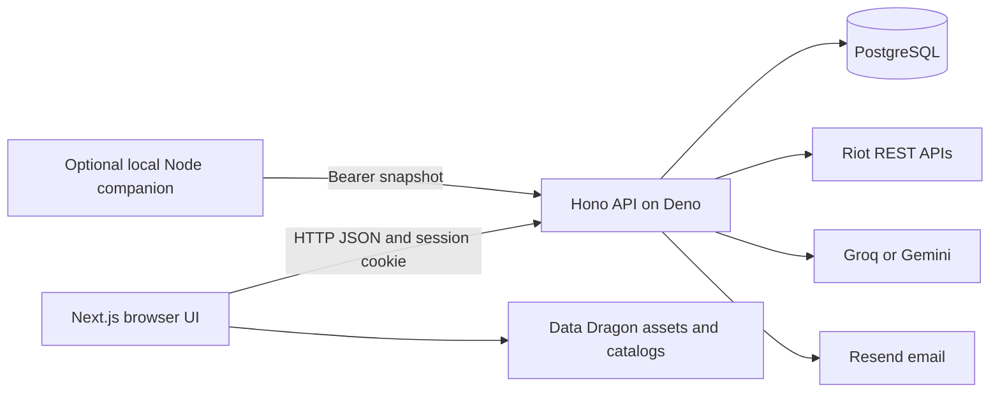

# Project Overview

Onboarding scope, analyzed commit/date, verification limits, and open questions: [latest_session_work.md](latest_session_work.md).

## Purpose and verified architecture

Diff is a Spanish-language League of Legends performance coach for Seminario Profesional 2: link a Riot account, import matches, review performance, detect weaknesses, and practice a weekly plan. Profiles personalize coaching; the UI also provides match review, an editorial Academy, opt-in ranking, and match preparation. Product intent: [README](../README.md), [proposal](../docs/propuesta.md); implemented entry points: [App Router pages](../frontend/app/dashboard), [API mounts](../backend/src/app.ts#L26).

Diff's Next.js/React frontend calls a separate TypeScript/Deno Hono API from the browser. `AppShell` checks `/auth/me`; `apiRequest` includes session cookies and `useResource` redirects 401s to login. The API queries PostgreSQL through Drizzle, runs synchronous ingestion/analysis, and calls external services. Startup applies committed migrations before `Deno.serve`; `/health` checks the database. Sources: [AppShell:10](../frontend/app/components/AppShell.tsx#L10), [apiRequest:6](../frontend/app/lib/useResource.ts#L6), [main.ts:4](../backend/src/main.ts#L4), [app.ts:46](../backend/src/app.ts#L46).

Redis is provisioned but unused by the current ingestion implementation; no queue worker is implemented. The diagram omits build-time font downloads and backend catalog requests; see the canonical [technology and setup inventory](project_core_tech.md).

## Representative feature: weekly training and completion

This trace is verified in source and automated tests; it was not exercised as a live browser journey with a real Riot account.

1. **Input data:** `linkRiotAccount` / `syncRiotAccount` synchronously invoke `ingestMatches`. It requests ten recent Riot match IDs, reuses stored matches, saves participant stats, computes metrics, and attempts timeline storage. Missing timeline data leaves early-death metrics null. After ingestion it attempts weakness refresh. Sources: [ingest.ts:105](../backend/src/riot/ingest.ts#L105), [linkRiotAccount:262](../backend/src/riot/ingest.ts#L262), [syncRiotAccount:314](../backend/src/riot/ingest.ts#L314).
2. **Read screen state:** `/dashboard/entrenamiento` renders `TrainingHub`, which loads `/riot/weaknesses` and `useTrainingPlan`'s GET `/riot/training-plan`. The old `/dashboard/plan` redirects here. The UI asks for a linked account and ten metric-bearing matches before offering generation. Sources: [page](../frontend/app/dashboard/entrenamiento/page.tsx), [TrainingHub:55](../frontend/app/components/TrainingHub.tsx#L55), [redirect](../frontend/app/dashboard/plan/page.tsx).
3. **Analyze:** GET `/riot/weaknesses` may refresh stale rule versions. `saveWeaknesses` examines the latest ten participant rows, requires all ten to have metrics, and transactionally replaces detections. `detectWeaknesses` uses internal role references for farming, vision, consistency, team participation, and early deaths. These are practice heuristics, not official rank benchmarks; support is excluded from farming. Evidence contains participant UUIDs. Sources: [trainingRoutes:70](../backend/src/routes/training.ts#L70), [RULES_VERSION:10](../backend/src/analysis/weaknesses.ts#L10), [detectWeaknesses:69](../backend/src/analysis/weaknesses.ts#L69), [saveWeaknesses:182](../backend/src/analysis/weaknesses.ts#L182).
4. **Request generation:** the button invokes `useTrainingPlan.generate`, which POSTs `/riot/training-plan` via `apiRequest`. `trainingRoutes` verifies the JWT session and resolves the user's linked account: no session gives 401; no link gives 404. Sources: [hook:16](../frontend/app/lib/useTrainingPlan.ts#L16), [route:167](../backend/src/routes/training.ts#L167).
5. **Build plan:** `generateTrainingPlan` reuses an active plan for the current Monday–Sunday week. Otherwise it reads compact profile preferences, refreshes stale weaknesses, selects up to three by severity with goal tie-breaking, pairs focus items with drills, and can add champion recommendations from stored statistics. No drafts returns an empty plan. The backend does not independently enforce the UI's ten-match gate for every recommendation. Sources: [generateTrainingPlan:69](../backend/src/analysis/trainingPlan.ts#L69), [compactCoachContext:143](../backend/src/coaching/context.ts#L143), [getChampionStats:403](../backend/src/riot/ingest.ts#L403).
6. **Explain and persist:** each draft description plus profile preferences goes to `generateExplanation`, preferring Groq with eligible Gemini fallback. On any `LlmError`, all explanations revert to draft descriptions and `generatedBy` becomes `rules`. Writes store the plan and items with explicit `position` and evidence references. The LLM explains rule-selected actions; it does not select weaknesses. Sources: [generation/fallback:224](../backend/src/analysis/trainingPlan.ts#L224), [provider router:13](../backend/src/analysis/llm.ts#L13), [schema:133](../backend/src/db/schema.ts#L133).
7. **Complete and reload:** `useTrainingPlan.complete` POSTs an item progress URL. `verifyItemOwnership` validates the UUID and linked-account ownership before `markItemProgress` inserts `plan_progress`. GET derives `completed` from persisted progress and orders items by `position`; the UI's percentage counts drills only. Sources: [complete:37](../frontend/app/lib/useTrainingPlan.ts#L37), [ownership:42](../backend/src/routes/training.ts#L42), [progress route:180](../backend/src/routes/training.ts#L180), [getCurrentTrainingPlan:282](../backend/src/analysis/trainingPlan.ts#L282), [TrainingHub:90](../frontend/app/components/TrainingHub.tsx#L90).

Behavioral evidence: [backend plan tests](../backend/tests/trainingPlan.test.ts), [route/auth/ownership tests](../backend/tests/training-routes.test.ts), [detector tests](../backend/tests/weaknesses.test.ts), [TrainingHub UI tests](../frontend/tests/TrainingPlanView.test.tsx). Results live in [project_core_tech.md](project_core_tech.md#verification-results).

## Inferences

The backend is best understood as a modular monolith: route adapters and domain modules share one process and database. Synchronous ingestion and sequential plan explanations can extend request latency; Redis provision alone does not remove that coupling. These are architectural interpretations of the source, not load-test results.

## Reading order

Read this overview, then [project_structure.md](project_structure.md) for code navigation, [project_core_tech.md](project_core_tech.md) for storage/dependencies/setup, and [latest_session_work.md](latest_session_work.md) for evidence limits and the next investigation. Existing detailed Spanish references start at [docs/arquitectura.md](../docs/arquitectura.md); reconcile its claims against the cited implementation.
