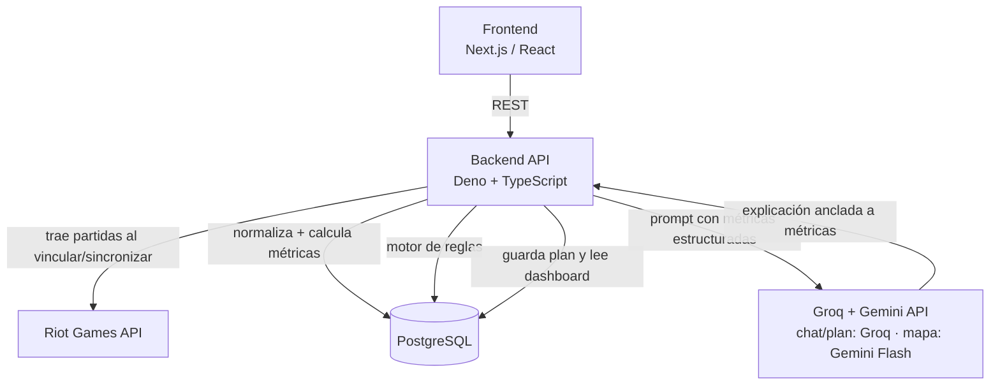

# Arquitectura y modelo de datos — Alcance Seminario Profesional 2

> Alcance de esta entrega: **solo League of Legends**. Motor de recomendación: **reglas + LLM (Groq + Gemini)**, sin motor de ML propio. Backend en **TypeScript/Deno**. Ver decisiones completas en la memoria del proyecto.
>
> El esquema está diseñado para que las funcionalidades adicionales sugeridas por el catedrático (individual vs. equipo, horario/sesión, setup/experimentos, cohortes) se puedan agregar **después**, sin rediseñar las tablas base. Al final de este documento hay una sección que explica cómo engancha cada una.

## 1. Arquitectura lógica



> **Nota de implementación (esta entrega):** la ingesta y el análisis corren **de forma síncrona dentro de la petición** a la API (al vincular la cuenta o al sincronizar), no en un worker en background. La cola de trabajos Redis + worker asíncrono quedan como **trabajo futuro** para desacoplar la ingesta de la petición HTTP (el `docker-compose` ya levanta un servicio Redis previsto para eso).

Flujo end-to-end:
1. Usuario se registra/inicia sesión y vincula su cuenta de Riot (`riot_accounts`).
2. El usuario dispara la ingesta de las últimas N partidas (`POST /riot/link` o `POST /riot/sync`); la API la ejecuta de forma síncrona.
3. La API descarga las partidas de la Riot API, normaliza los datos y calcula las métricas (KPIs).
4. El motor de reglas evalúa las métricas y detecta debilidades recurrentes.
5. Esas debilidades + métricas estructuradas se envían al LLM (Groq, con Gemini de respaldo ante cuota), que genera la explicación en lenguaje natural del plan semanal, anclada a los datos (grounding obligatorio — el prompt exige citar la métrica exacta, no inventar causas). Si el LLM falla, el plan se entrega igual en modo solo-reglas.
6. El dashboard muestra historial, tendencias y el plan actual.
7. El usuario marca cumplimiento de cada ítem del plan → en la siguiente ventana de partidas el sistema reevalúa.

## 2. Modelo de datos

El modelo entidad-relación completo (diagrama, diccionario de datos y decisiones de normalización) está en su propio documento: [modelo-entidad-relacion.md](modelo-entidad-relacion.md).

Resumen de entidades: `users`, `player_profiles`, `riot_accounts`, `ingestion_jobs`, `matches`, `match_participants`, `match_metrics`, `weaknesses`, `training_plans`, `training_plan_items`, `plan_progress`.

## 3. Cómo engancharían las funcionalidades futuras (sin rediseñar lo anterior)

| Funcionalidad | Cómo se agrega después |
|---|---|
| Individual vs. equipo | Query nueva sobre `match_participants` (ya tiene las 10 filas) — sin tabla nueva. |
| Rendimiento por horario/sesión | Query nueva sobre `matches.game_creation` — sin tabla nueva. |
| Setup + experimentos A/B | Tablas nuevas `player_setups`, `setup_change_events`, `experiments` con FK a `riot_accounts` — no tocan las tablas existentes. |
| Cohortes comparables | Servicio de solo lectura que agrega `match_metrics` agrupando por rol/rango/región — no tocan las tablas existentes (requiere sí tener suficiente volumen de jugadores, o datos públicos agregados). |
| Multi-juego / adapters (visión de tesis) | Se reemplazaría `matches`/`match_participants` por una capa de adapter que normalice al mismo modelo — es el cambio más grande, por eso se dejó fuera de esta entrega. |

## 4. Endpoints REST (backend Deno + Hono)

Rutas realmente implementadas (prefijos montados en `app.ts`: `/auth`, `/riot`, `/ai`, `/settings`, `/player`, `/preparation`):

```
# Salud
GET    /health                                   # estado del servicio y de la DB

# Autenticación (/auth)
POST   /auth/register
POST   /auth/login
POST   /auth/logout
GET    /auth/me
POST   /auth/verify-email
POST   /auth/forgot-password
POST   /auth/reset-password

# Cuenta de Riot e ingesta (/riot)
POST   /riot/link                                # vincula cuenta de Riot + ingesta inicial síncrona
POST   /riot/sync                                # re-sincroniza partidas recientes
GET    /riot/account                             # cuenta vinculada + partidas recientes

# Historial y detalle (/riot)
GET    /riot/matches                              # page, limit, result (all|win|loss), queue (all|solo|flex|normal|aram)
GET    /riot/matches/:id                          # UUID interno; requiere que la partida pertenezca al usuario
POST   /riot/matches/:id/insights                 # consejos Gemini/Groq por evento; caché en match_metrics.extra

# Configuración (/settings)
GET    /settings/profile                         # email y datos básicos de la cuenta vinculada
POST   /settings/change-password                 # currentPassword, newPassword
DELETE /settings/riot-account                    # password; elimina el vínculo y datos derivados
DELETE /settings/account                         # password y confirmation=ELIMINAR

# Análisis y plan (/riot)
GET    /riot/weaknesses                           # debilidades, muestra y partidas de evidencia de la cuenta
GET    /riot/training-plan                        # plan de entrenamiento actual
POST   /riot/training-plan                        # crea el plan semanal o devuelve el existente
POST   /riot/training-plan/items/:itemId/progress # marca cumplimiento de un ítem

# Asistente IA (/ai)
POST   /ai/chat                                   # chat de coach anclado a las métricas del usuario
```

### Historial y detalle de partidas

El historial pagina **todas las partidas acumuladas** en PostgreSQL y filtra por resultado y cola; no solicita nuevas partidas a Riot. `summary` agrega victorias/derrotas y promedios de métricas sobre el conjunto filtrado completo, sin aplicar paginación; `metricsCount` identifica la muestra válida de los promedios y `storedTotal` distingue una cuenta sin partidas de filtros sin resultados. La sincronización conserva la ventana de 10 partidas recientes.

`GET /riot/weaknesses` añade `linked`, `sample` (métricas disponibles en la misma ventana de diez filas del detector) y `evidenceMatches`. Resuelve los identificadores de participantes de `evidence` mediante consulta restringida a la cuenta autenticada, sin devolver payloads de Riot ni exponer partidas ajenas.

Plan y práctica comparten `/dashboard/entrenamiento`; `/dashboard/plan` redirige al plan dentro de esa pantalla. Generación y progreso reutilizan las rutas existentes, sin migraciones. El indicador de cumplimiento cuenta solo ítems `drill`; los ítems de foco/campeones mantienen su registro individual. No se presenta cumplimiento como evidencia de mejora de rendimiento.

La migración `0008` agrega `matches.raw_detail` y `matches.raw_timeline` (JSONB). La ingesta conserva el detalle completo y el timeline que ya descargaba. Al abrir una partida antigua, la API comprueba primero su propiedad y recupera únicamente los datos de caché que falten, con consultas agrupadas por partida y un límite de espera de 8 segundos por consulta. Si Riot falla, devuelve las métricas guardadas y avisa que el detalle está incompleto; no inventa participantes ni eventos. Los payloads completos permanecen en la base y no se incluyen en el dashboard ni en el historial.

El detalle muestra equipos, objetos y eventos reales de kills/deaths/assists del jugador. La visualización de posiciones es aproximada y solo se activa para `mapId=11`. Detalle y entrenamiento usan el mapa ilustrado extraído del template del usuario. Los eventos se proyectan mediante una homografía calibrada con nueve torres de la ilustración (ver [calibración](calibracion-mapa.md)); las flechas curvas unen eventos con alternativas de retirada, visión o agrupamiento. `POST /riot/matches/:id/insights` vuelve a comprobar propiedad, toma métricas/eventos del servidor y analiza todos los eventos del jugador mediante lotes consecutivos de hasta cuatro eventos, sin muestreo ni límite total de evaluaciones. Solo admite índices de eventos existentes y acciones permitidas; guarda el resultado por jugador/partida en `match_metrics.extra.mapInsights` y agrupa consultas simultáneas. El prompt exige recomendaciones condicionales y no atribuir causas no verificadas. Si la IA falla, las evaluaciones ya guardadas siguen visibles y se puede continuar desde el progreso persistido. No requiere una migración adicional a `0008`.

Los endpoints de configuración requieren sesión y las operaciones sensibles comprueban la contraseña actual. La eliminación de datos es transaccional: borra dependencias en orden y conserva partidas compartidas con otras cuentas. Desvincular Riot conserva el usuario de acceso. Una ingesta en curso impide borrar o desvincular hasta que finalice.

## Proveedores del coach y privacidad

`analysis/llm.ts` centraliza el enrutamiento: chat y explicaciones del plan prefieren **Groq**; `matchMap.ts` prefiere **Gemini Flash**. Las claves se leen solo en el servidor. `GEMINI_API_KEY` es opcional: sin ella se conserva Groq para todo; con una sola clave se usa ese proveedor. `GEMINI_MODEL` permite seleccionar otro modelo disponible en AI Studio.

Cada solicitud intenta una vez el proveedor preferido y, ante cuota/429 o fallos transitorios (5xx, 408, red o timeout), el otro. Configuración, peticiones inválidas y formato fallan sin respaldo; si ambos intentos fallan se conserva la clasificación del error. Si ambos tienen cuota agotada, se devuelve la espera hasta la primera disponibilidad y se evitan nuevas llamadas al proveedor bloqueado durante ese plazo. No hay reintentos recursivos. El plan conserva su modo solo-reglas; chat permite reintento y mapa conserva sus lotes guardados.

Gemini usa `https://generativelanguage.googleapis.com/v1beta/openai/chat/completions` con Bearer, `response_format: json_schema`/`strict: true` y `reasoning_effort: low`; su límite de respuesta se envía como `max_tokens` (Groq conserva `max_completion_tokens`). El transporte común clasifica también una clave Gemini inválida reportada como HTTP 400/`API_KEY_INVALID`. La validación del mapa en el servidor sigue siendo obligatoria: no se confía solo en el esquema del proveedor. Compatibilidad revisada en la [documentación oficial de Google](https://ai.google.dev/gemini-api/docs/openai); pruebas automatizadas con respuestas simuladas y prueba real sintética satisfactoria (JSON estricto, razonamiento bajo y límite de salida), sin datos de jugadores. El modelo predeterminado sigue el [catálogo de Google](https://ai.google.dev/gemini-api/docs/models); cuotas reales por proyecto/modelo se consultan en [AI Studio](https://ai.google.dev/gemini-api/docs/rate-limits), sin asumir un TPM/RPD fijo.

**Privacidad:** los prompts incluyen datos de partidas, perfil y, según el contexto, nombres de invocadores. Con ambos proveedores configurados, esos datos pueden enviarse a cualquiera de ellos por el respaldo automático. En los servicios gratuitos de Gemini, Google puede utilizar prompts y respuestas para mejorar sus productos; los [términos de Gemini](https://ai.google.dev/gemini-api/terms#unpaid-services) describen el uso de datos y excepciones regionales. No se envían contraseñas, cookies ni claves de proveedores. Revisar estos términos antes de usar datos de terceros o desplegar públicamente.

## 5. Stack confirmado

- Frontend: React + TypeScript / Next.js
- Backend: Deno + TypeScript
- Base de datos: PostgreSQL
- Cola: Redis + worker asíncrono — **previsto como trabajo futuro**; en esta entrega la ingesta corre síncrona dentro de la API (el servicio Redis del `docker-compose` queda reservado para esta evolución)
- IA: Groq (`openai/gpt-oss-20b`) + Gemini Flash (`GEMINI_MODEL`, predeterminado `gemini-3.8-flash`), mediante endpoints compatibles con OpenAI; grounding obligatorio por prompt y modo solo-reglas para el plan si el LLM falla
- Riot API: SDK TS (`twisted`) o llamadas REST directas
- Contenedores: Docker
- CI/CD: GitHub Actions

### Contexto y evaluación de jugadas del mapa (versión 4)

Se evalúan todos los eventos de muertes, asesinatos y asistencias con posición registrados para el jugador. Cada petición procesa el siguiente lote pendiente (máximo cuatro eventos; se reduce según el tamaño del contexto) y guarda el resultado antes de continuar; pasar el cursor no llama al LLM. `focus=all|highlights|mistake|good` prioriza el orden de los candidatos según el filtro, conservando la clasificación completa: una muerte también puede ser un intercambio favorable y un asesinato puede contener un error. Además de rol, resultado y métricas finales, se envían duración, cola, parche, equipo/composición y el contexto local extraído del timeline por `analysis/matchContext.ts`:

- Campeones implicados y marcador anterior al evento.
- Última instantánea anterior: nivel, oro total/sin gastar, CS y vida; antigüedad explícita, máximo 90 s.
- Comparación de oro/CS/nivel con el rival del mismo rol.
- Posición propia de la instantánea anterior (hasta 90 s); posiciones cercanas solo si tiene como máximo 30 s; no representan un conteo exacto de la pelea. La interfaz usa posiciones aliadas para agrupamiento solo con ≤15 s de antigüedad y muestra esa edad.
- Compras y wards de los 120 s anteriores; los wards registrados no equivalen a cobertura activa.
- Bajas a ≤2000 unidades en ±15 s y objetivos registrados entre 90 s antes y 30 s después, sin atribuirles causalidad.

El contrato devuelve `suggestions` (diagnóstico `mistakeTitle`/`mistake`, valoración `error` o `possible_error`, alternativa `title`/`advice` y acción de mapa), `goodPlays` (título y explicación del acierto), `observations` (evaluación contextual cuando la evidencia no permite clasificarlo como error/acierto) y `progress` (`evaluated`, `total`, `complete`). Los índices son únicos y mutuamente excluyentes entre las tres listas. Solo se marca completo cuando cubren todos los eventos. El rojo se reserva para diagnósticos del coach, el amarillo para su alternativa y el azul para aciertos evaluados; una muerte o un asesinato no determinan por sí solos el color. Cada punto visible tiene una evaluación. El gris identifica evaluaciones contextuales con explicación concreta del coach, no eventos omitidos. Durante la generación solo aparecen puntos completados y se indica cuántos quedan por evaluar. Los datos del timeline quedan en un desplegable del tooltip. El prompt exige tuteo, un dato local y una decisión concreta; evita el texto genérico de revisar la repetición. No conoce oleadas, cobertura exacta de visión ni enfriamientos. La caché actual es versión 5 e incorpora las preferencias del jugador; el frontend acepta revisiones de caché desde la 4 con el mismo contrato de evaluaciones/progreso, sin confundir revisión de caché con versión del contrato HTTP. La caché anterior se regenera automáticamente; se conserva en `match_metrics.extra`, sin migración nueva. El mapa se limita a 960 px y reproduce el hover del template: ampliación centrada 1.1×, transición de 0.35 s y bordes transparentes visibles sin recorte rectangular. Mapa, eventos y flechas comparten transformación. Las flechas tienen gradiente rojo en movimiento sobre toda la línea y resplandor tenue, sin partícula independiente; los puntos pulsan cada 1.8 s, como en el template. Se respeta la preferencia de movimiento reducido.

El mapa toma `coachName` del mismo `AiChatContext` que usa el chat, de modo que conserva el campamento elegido al navegar. Tooltips, contador y estados identifican al coach; el número de consejos se escribe en palabras. Zoom y flechas quedan activos sin checkboxes.

El análisis solicita `response_format: json_schema` con `strict: true`, una propiedad obligatoria `event_<índice>` por cada evento del lote. Así no puede omitir un evento ni repetir otro para aparentar cobertura. El servidor exige explicación no vacía por evento y alternativa para cada error; un lote incompleto se rechaza. Usa razonamiento bajo, un presupuesto de respuesta proporcional al lote (hasta 4096 tokens) y un timeout de 45 s; el chat usa 25 s por intento. La validación del servidor mantiene la exclusión entre índices y acota los textos sin descartar una evaluación completa por exceder el largo recomendado. Respuestas incompletas, configuración, timeout y cuota producen errores diferenciados. Ante HTTP 429 o un fallo transitorio del servicio se intenta primero el otro proveedor configurado. Si ninguno está disponible por cuota, se respeta `Retry-After` (60 s si no está presente) y se muestra una cuenta regresiva hasta que alguno pueda volver a atender. La espera por proveedor se comparte entre mapa, chat y plan dentro del proceso del backend. Tras la espera se reanuda automáticamente, hasta tres veces consecutivas si sigue sin avanzar; después queda disponible el reintento manual. Cada lote exitoso restablece ese contador. Los resultados ya guardados siguen accesibles. Durante carga/error se mantienen las evaluaciones completadas y todos los filtros disponibles; cambiar de filtro reutiliza lo analizado y prioriza los siguientes candidatos. El progreso persistido permite continuar tras recargar o navegar, sin volver a enviar eventos ya evaluados. Las evaluaciones contextuales explican qué muestran los datos y qué conclusión no se puede establecer, sin inventar errores ni aciertos.

La proyección se centraliza en `lib/riftProjection.ts` y sus nueve referencias medidas sobre esta imagen. Los destinos de `lib/riftMap.ts` usan posiciones aliadas recientes u objetivos cercanos si constan en el timeline; en su ausencia describen zonas locales orientativas, sin señalar una posición aliada inventada. [Método, fuentes y figura de calibración](calibracion-mapa.md).

### Exploración de la partida

`MatchReviewProvider` comparte el análisis y la selección entre `MatchCoachSummary` y `MatchEventMap`. `useMatchInsights` conserva una sola secuencia de solicitudes/caché y la espera ante 429; generar el resumen no hace una consulta LLM adicional. El resumen elige ejemplos existentes, prioriza un error confirmado sobre hipótesis y muestra estados vacíos/parciales sin inventar evaluaciones ni una jerarquía de severidad. Las fases temporales solo filtran la presentación, conservando los índices originales del timeline y la cobertura completa del backend. La selección explícita (clic, toque o Enter/Espacio) fija el panel y atenúa otros marcadores/flechas; hover/foco permite una previsualización. `Tooltip` expone estas opciones de forma optativa para conservar su comportamiento en los demás componentes. `MatchSectionNav` enlaza las regiones accesibles de resumen/equipos/mapa, sigue el desplazamiento y respeta movimiento reducido.


## Perfil, aprendizaje y comunidad (incremento 2026-10-15)

La migración **0009** agrega el perfil opcional uno a uno del usuario, la versión de reglas aplicada a la cuenta y la fecha de sincronización del rango. Las rutas `/player/profile`, `/player/ranking`, `/preparation/catalog` y `/preparation/guide` requieren sesión. El registro acepta preferencias opcionales en la misma transacción que crea el usuario. El ranking publica solo participantes que dieron consentimiento, por región y rango oficial Solo/Dúo. Universidad es opcional y autodeclarada.

El chat obtiene perfil, muestra reciente por rol, debilidades, plan/cumplimiento y partida propia desde el servidor; recibe un historial acotado para continuidad y deja de confiar en estadísticas suministradas por el cliente. Las reglas usan referencias internas por rol y excluyen soporte del objetivo de CS. Los nuevos planes adaptan prioridad/ejercicios al perfil y tiempo disponible; no sustituyen un plan activo. El mapa incluye preferencias compactas, con caché v5 ligada a su revisión, sin cambiar coordenadas ni reducir cobertura de eventos.

La Academia es un catálogo editorial versionado con 73 términos originales y trece guías; los enlaces en consejos se resuelven localmente, sin HTML ni URLs del LLM. La preparación manual usa plantillas transparentes y catálogos de Data Dragon con caché de una hora en el servidor; no usa Groq ni acceso automático al cliente. El detalle de contratos, fuentes, criterios y limitaciones está en [perfil-academia-comunidad.md](perfil-academia-comunidad.md).
