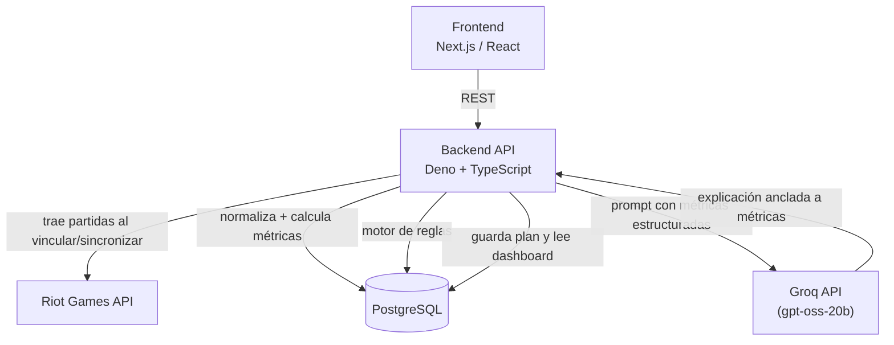

# Arquitectura y modelo de datos — Alcance Seminario Profesional 2

> Alcance de esta entrega: **solo League of Legends**. Motor de recomendación: **reglas + LLM (Groq)**, sin motor de ML propio. Backend en **TypeScript/Deno**. Ver decisiones completas en la memoria del proyecto.
>
> El esquema está diseñado para que las funcionalidades adicionales sugeridas por el catedrático (individual vs. equipo, horario/sesión, setup/experimentos, cohortes) se puedan agregar **después**, sin rediseñar las tablas base. Al final de este documento hay una sección que explica cómo engancha cada una.

## 1. Arquitectura lógica



> **Nota de implementación (esta entrega):** la ingesta y el análisis corren **de forma síncrona dentro de la petición** a la API (al vincular la cuenta o al sincronizar), no en un worker en background. La cola de trabajos Redis + worker asíncrono quedan como **trabajo futuro** para desacoplar la ingesta de la petición HTTP (el `docker-compose` ya levanta un servicio Redis previsto para eso).

Flujo end-to-end:
1. Usuario se registra/inicia sesión y vincula su cuenta de Riot (`riot_accounts`).
2. El usuario dispara la ingesta de las últimas N partidas (`POST /riot/link` o `POST /riot/sync`); la API la ejecuta de forma síncrona.
3. La API descarga las partidas de la Riot API, normaliza los datos y calcula las métricas (KPIs).
4. El motor de reglas evalúa las métricas y detecta debilidades recurrentes.
5. Esas debilidades + métricas estructuradas se envían al LLM (Groq), que genera la explicación en lenguaje natural del plan semanal, anclada a los datos (grounding obligatorio — el prompt exige citar la métrica exacta, no inventar causas). Si el LLM falla, el plan se entrega igual en modo solo-reglas.
6. El dashboard muestra historial, tendencias y el plan actual.
7. El usuario marca cumplimiento de cada ítem del plan → en la siguiente ventana de partidas el sistema reevalúa.

## 2. Modelo de datos

El modelo entidad-relación completo (diagrama, diccionario de datos y decisiones de normalización) está en su propio documento: [modelo-entidad-relacion.md](modelo-entidad-relacion.md).

Resumen de entidades: `users`, `riot_accounts`, `ingestion_jobs`, `matches`, `match_participants`, `match_metrics`, `weaknesses`, `training_plans`, `training_plan_items`, `plan_progress`.

## 3. Cómo engancharían las funcionalidades futuras (sin rediseñar lo anterior)

| Funcionalidad | Cómo se agrega después |
|---|---|
| Individual vs. equipo | Query nueva sobre `match_participants` (ya tiene las 10 filas) — sin tabla nueva. |
| Rendimiento por horario/sesión | Query nueva sobre `matches.game_creation` — sin tabla nueva. |
| Setup + experimentos A/B | Tablas nuevas `player_setups`, `setup_change_events`, `experiments` con FK a `riot_accounts` — no tocan las tablas existentes. |
| Cohortes comparables | Servicio de solo lectura que agrega `match_metrics` agrupando por rol/rango/región — no tocan las tablas existentes (requiere sí tener suficiente volumen de jugadores, o datos públicos agregados). |
| Multi-juego / adapters (visión de tesis) | Se reemplazaría `matches`/`match_participants` por una capa de adapter que normalice al mismo modelo — es el cambio más grande, por eso se dejó fuera de esta entrega. |

## 4. Endpoints REST (backend Deno + Hono)

Rutas realmente implementadas (prefijos montados en `app.ts`: `/auth`, `/riot`, `/ai`):

```
# Salud
GET    /health                                   # estado del servicio y de la DB

# Autenticación (/auth)
POST   /auth/register
POST   /auth/login
POST   /auth/logout
GET    /auth/me
POST   /auth/verify-email
POST   /auth/forgot-password
POST   /auth/reset-password

# Cuenta de Riot e ingesta (/riot)
POST   /riot/link                                # vincula cuenta de Riot + ingesta inicial síncrona
POST   /riot/sync                                # re-sincroniza partidas recientes
GET    /riot/account                             # cuenta vinculada + partidas recientes

# Análisis y plan (/riot)
GET    /riot/weaknesses                           # debilidades detectadas por el motor de reglas
GET    /riot/training-plan                        # plan de entrenamiento actual
POST   /riot/training-plan                        # (re)genera el plan semanal
POST   /riot/training-plan/items/:itemId/progress # marca cumplimiento de un ítem

# Asistente IA (/ai)
POST   /ai/chat                                   # chat de coach anclado a las métricas del usuario
```

## 5. Stack confirmado

- Frontend: React + TypeScript / Next.js
- Backend: Deno + TypeScript
- Base de datos: PostgreSQL
- Cola: Redis + worker asíncrono — **previsto como trabajo futuro**; en esta entrega la ingesta corre síncrona dentro de la API (el servicio Redis del `docker-compose` queda reservado para esta evolución)
- IA: Groq API (modelo `openai/gpt-oss-20b`) vía su endpoint compatible con OpenAI (`/openai/v1/chat/completions`); grounding obligatorio por prompt y fallback a solo-reglas si el LLM falla
- Riot API: SDK TS (`twisted`) o llamadas REST directas
- Contenedores: Docker
- CI/CD: GitHub Actions
