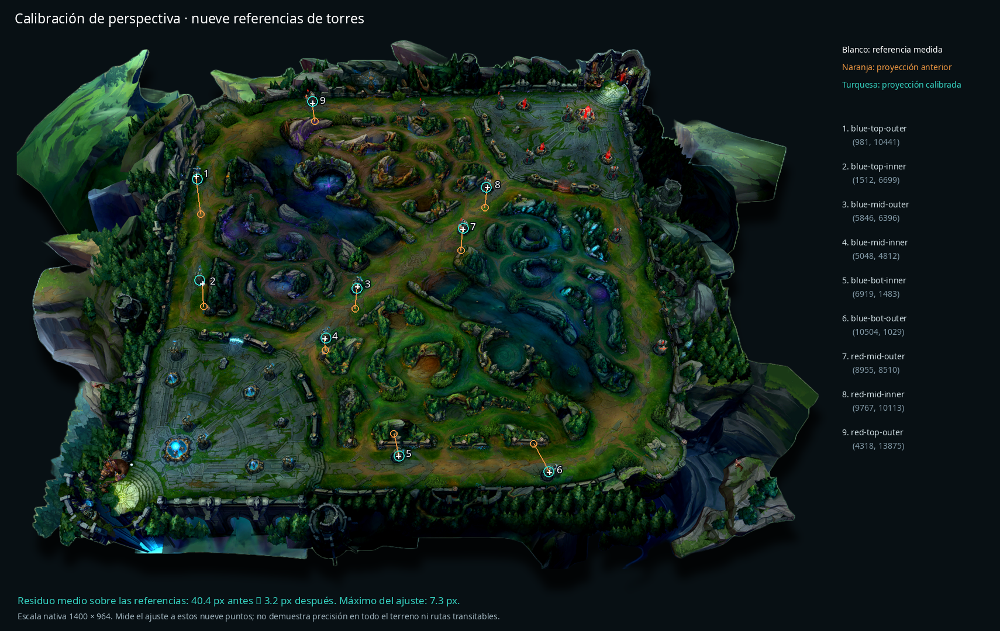

# Calibración del mapa de partida

La ilustración `frontend/public/maps/rift-template.png` tiene perspectiva y bordes transparentes. Las coordenadas del timeline están en el plano del juego; dividirlas por 15000 y colocarlas directamente como porcentajes no reproduce esa perspectiva.

## Referencias y método

`frontend/app/lib/riftProjection.ts` ajusta una homografía por mínimos cuadrados usando nueve torres distribuidas entre las tres líneas y ambos equipos. Las coordenadas del juego proceden del [ejemplo de timeline de RiotTuxedo](https://gist.github.com/RiotTuxedo/ab04ac027546f711ce820faed394295b) y los [eventos publicados en RiotGames/developer-relations #520](https://github.com/RiotGames/developer-relations/issues/520). Los píxeles se midieron sobre el punto de contacto de cada torre con el suelo de esta ilustración de 1400 × 964, no sobre la parte superior del modelo.

El ajuste se calcula una vez al cargar el módulo. Cada evento y destino sugerido usa la misma transformación. Se conservan las coordenadas originales y las agrupaciones de eventos; no se introducen desplazamientos para separar círculos ni correcciones distintas por equipo. Los márgenes transparentes quedan incluidos en las medidas.

| Referencia | Coordenadas del juego X, Y | Píxeles de referencia X, Y |
| --- | --- | --- |
| Azul superior exterior | 981, 10441 | 315, 241 |
| Azul superior interior | 1512, 6699 | 326, 425 |
| Azul central exterior | 5846, 6396 | 591, 430 |
| Azul central interior | 5048, 4812 | 535, 519 |
| Azul inferior interior | 6919, 1483 | 661, 720 |
| Azul inferior exterior | 10504, 1029 | 919, 748 |
| Rojo central exterior | 8955, 8510 | 771, 332 |
| Rojo central interior | 9767, 10113 | 813, 260 |
| Rojo superior exterior | 4318, 13875 | 514, 116 |



El residuo medio sobre estas nueve referencias pasa de **40,39 px** con la interpolación anterior a **3,16 px** con el ajuste, con un máximo de **7,32 px**, a resolución nativa. Estas cifras describen el ajuste a los puntos usados para calibrar: no son una validación independiente de toda la superficie ni garantizan que el terreno de cada parche coincida con la ilustración. Si cambia el archivo del mapa, se deben volver a medir las referencias.

## Qué representa cada punto

- Los eventos usan `CHAMPION_KILL.position`, también cuando el jugador participa como asistente. Representan el lugar de la baja; no la posición exacta de todos sus participantes.
- Las flechas y puntos amarillos son alternativas orientativas, no recorridos observados ni rutas calculadas sobre obstáculos.
- Agrupamiento: usa la posición previa del aliado más cercano cuando la instantánea tiene como máximo 15 s de antigüedad y ese aliado está a ≤3000 unidades del evento. El tooltip indica el campeón y la antigüedad. Si falta esa información, indica una dirección orientativa hacia el lado del jugador.
- Visión: usa como referencia un objetivo cercano del contexto cuando tiene posición (≤5000 unidades), o una zona local hacia el río. El desplazamiento sugerido se limita para mantenerlo cerca del evento; no representa un ward observado.
- Retirada: propone una dirección local hacia la base propia. El segmento no asegura que el terreno sea transitable.

`analysis/matchContext.ts` expone las posiciones de la instantánea y de los objetivos desde el timeline ya guardado. No añade llamadas a Riot ni una migración. Las explicaciones Groq existentes siguen siendo válidas; no se invalida su caché por cambiar la proyección.

## Cargar el cambio

El frontend en modo desarrollo recoge la nueva proyección al recargar. Reconstruir el backend expone las posiciones contextuales nuevas para las sugerencias:

```bash
docker compose up -d --build backend
```

Si el frontend también corre en contenedor, reconstruirlo junto con el backend.
